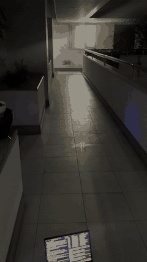
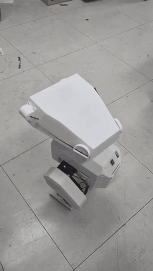
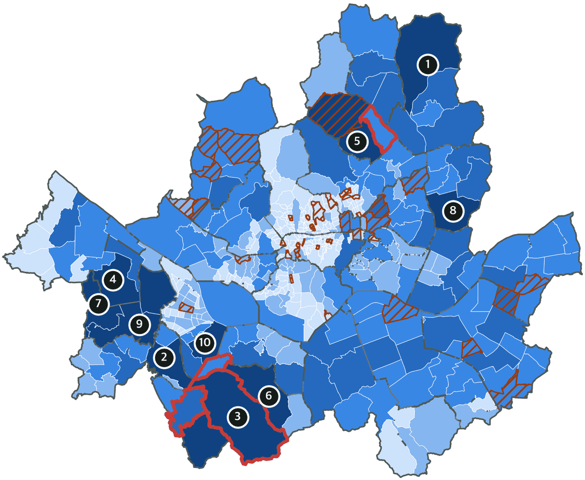
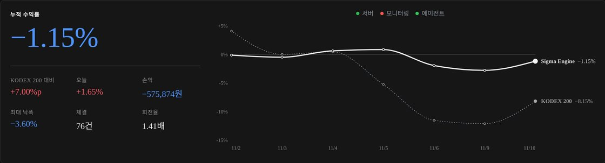

<h1 align="center">Hi, I'm Lee 👋</h1>

  University of Seoul · Seoul, Korea

<h3 align="center">
  1. Technology should face people. 
  2. Failure is data.
</h3>

  <b>Language</b> 
  
  
   
  <b>Robotics</b> 
  
  
  
  
  
   
  <b>Hardware</b> 
  
  
  
  
   
  <b>AI & agents</b> 
  
  
  
   
  <b>Tools</b> 
  
  
  
  
  
  

---
### Snapshots

<table>
  <tr>
    <td width="200" valign="top">
       
      <b>3ddsg-drone-navigation</b> Crazyflie flight test, at night
    </td>
    <td width="200" valign="top">
       
      <b>open-duck-mini-v2</b> Walking policy on the real robot
    </td>
    <td valign="top">
       
      <b>steps-before-crashes</b> Expected crashes per dong, and the 10 dongs to inspect first
    </td>
  </tr>
  <tr>
    <td colspan="3">
       
      <b>sigma-engine</b> · live dashboard: the agent's account against the KODEX 200 index
    </td>
  </tr>
</table>

### In the physical world

| | Project | What it does |
|---|---|---|
| 🚁 | [**3ddsg-drone-navigation**](https://github.com/isopink/3ddsg-drone-navigation) | A Crazyflie flies room to room in a real building, using an IFC-based 3D dynamic scene graph as its map. |
| 🤖 | [**object-finder-bot**](https://github.com/isopink/object-finder-bot) | "Where is the blue mug?" A TurtleBot3 remembers what it saw and drives back to it, then checks the object is still there. |
| 🦆 | [**open-duck-mini-v2**](https://github.com/isopink/open-duck-mini-v2) | A 3D-printed biped walking on a Raspberry Pi. I built it, run it, and trained forward, backward and posture policies in Isaac Lab. |

### In cities, markets and data

| | Project | What it does |
|---|---|---|
| 🚶 | [**steps-before-crashes**](https://github.com/isopink/steps-before-crashes) | Where older people walk vs. where they get hit, across Seoul's 467 legal dongs. Closed mobile and crash data pick the 10 dongs to inspect first. *(2026 Data Safe Zone Competition)* |
| 📈 | [**sigma-engine**](https://github.com/isopink/sigma-engine) | Trading agent for Korean equities. Every order comes from the AI, and a hook blocks any order that breaks a risk limit. [Live dashboard](https://isopink.github.io/sigma-engine/) |
| 🏢 | [**interview-prep-agent**](https://github.com/isopink/interview-prep-agent) | Interview prep from DART filings. Rules pick the findings, Solar Pro writes, a verifier checks every number. *(Upstage MABC 2026 final)* [Live service](https://why-this-company.onrender.com) |
| 🗓️ | [**career-log**](https://github.com/isopink/career-log) | AI job-search journal built at the 2026 Codex Community Hackathon. |

### Tools I made along the way

| | Project | What it does |
|---|---|---|
| 📑 | [**paper-review-deck**](https://github.com/isopink/paper-review-deck) | A Claude skill that turns papers into a full review talk: reproduction, slides, visual QA, speaker script. |
