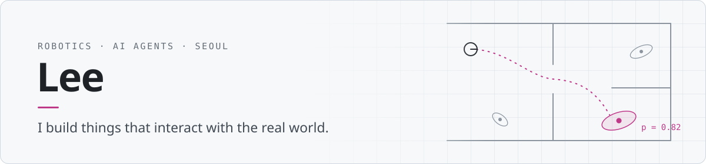

<picture>
  <source media="(prefers-color-scheme: dark)" srcset="assets/banner-dark.svg">
  
</picture>

 

Robots and LLM agents are the tools. What counts is whether something real got better: a robot that finds the thing you lost, a drone that gets through a real building, a service that gets someone ready for an interview.

UNIVERSITY OF SEOUL &nbsp;·&nbsp; SEOUL, KOREA

 

## Work

#### Physical world

<table>
  <tr>
    <td width="270"><a href="https://github.com/isopink/3ddsg-drone-navigation"><b>3ddsg-drone-navigation</b></a></td>
    <td>A Crazyflie flies room to room in a real building, using an IFC-based 3D dynamic scene graph as its map.</td>
  </tr>
  <tr>
    <td><a href="https://github.com/isopink/object-finder-bot"><b>object-finder-bot</b></a></td>
    <td>"Where is the blue mug?" A TurtleBot3 remembers what it saw, drives back to it, and checks the object is still there.</td>
  </tr>
  <tr>
    <td><a href="https://github.com/Pseudo-Lab/Sim2Real-Walking-Robot"><b>Sim2Real-Walking-Robot</b></a> Pseudo-Lab S13</td>
    <td>Walking policies trained in MuJoCo, run on low-cost bipeds, and the gap between the two measured.</td>
  </tr>
</table>

#### Cities, markets and data

<table>
  <tr>
    <td width="270"><a href="https://github.com/isopink/steps-before-crashes"><b>steps-before-crashes</b></a> 2026 Data Safe Zone Competition</td>
    <td>Where older people walk vs. where they get hit, across Seoul's 467 legal dongs. Closed mobile and crash data pick the 10 dongs to inspect first.</td>
  </tr>
  <tr>
    <td><a href="https://github.com/isopink/Sigma-Engine"><b>Sigma-Engine</b></a> <a href="https://isopink.github.io/Sigma-Engine/">Live dashboard</a></td>
    <td>Trading agent for Korean equities. Every order comes from the AI, and a hook blocks any order that breaks a risk limit.</td>
  </tr>
  <tr>
    <td><a href="https://github.com/isopink/Interview_prep_agent"><b>Interview_prep_agent</b></a> Upstage MABC 2026 final &nbsp;·&nbsp; <a href="https://why-this-company.onrender.com">Live service</a></td>
    <td>Interview prep from DART filings. Rules pick the findings, Solar Pro writes, a verifier checks every number.</td>
  </tr>
  <tr>
    <td><a href="https://github.com/isopink/CareerLog"><b>CareerLog</b></a> 2026 Codex Community Hackathon</td>
    <td>AI job-search journal.</td>
  </tr>
</table>

#### Tools

<table>
  <tr>
    <td width="270"><a href="https://github.com/isopink/paper-review-deck"><b>paper-review-deck</b></a></td>
    <td>A Claude skill that turns papers into a full review talk: reproduction, slides, visual QA, speaker script.</td>
  </tr>
</table>

 

## Principles

**Value lives outside the screen.** 
What I build is judged by what changes in the room, the building, or the market, not by the demo.

**People make the decisions.** 
The system brings the evidence: the numbers, the source, what it saw and where. The person chooses.

**Failure is data.** 
Every fall, every lost flight, every wrong guess gets recorded and becomes the next rule.

 

## Toolbox

<table>
  <tr>
    <td width="270">ROBOTICS</td>
    <td width="576">ROS 2 &nbsp;·&nbsp; Nav2 &nbsp;·&nbsp; MuJoCo &nbsp;·&nbsp; NVIDIA Jetson &nbsp;·&nbsp; Linux</td>
  </tr>
  <tr>
    <td>AI AND AGENTS</td>
    <td>PyTorch &nbsp;·&nbsp; Claude Code &nbsp;·&nbsp; MCP</td>
  </tr>
  <tr>
    <td>SOFTWARE</td>
    <td>Python &nbsp;·&nbsp; FastAPI &nbsp;·&nbsp; PostgreSQL &nbsp;·&nbsp; Docker &nbsp;·&nbsp; Git</td>
  </tr>
</table>
